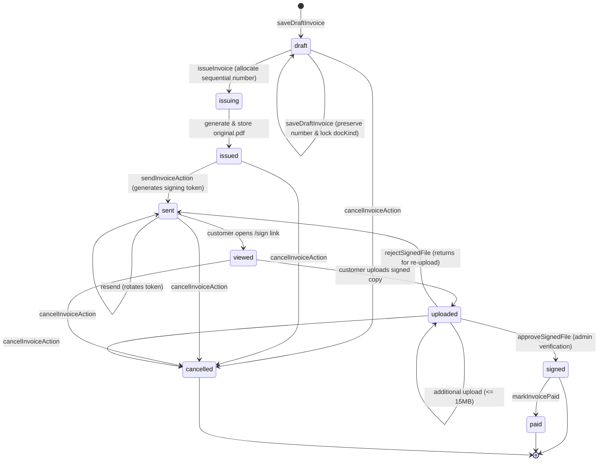

# RASHX Platform HQ — Performance & Architecture Guide

This document describes the caching strategy, database indexing, regional deployment topology, storage layout, customer digital signing flow, and contract management architecture for the central platform administration dashboard (`admin.rashx.org` / `/[locale]/dashboard`) and customer signing portal.

---

## 1. Cache Tags & Invalidation Matrix

Every platform read function in `src/server/data/*` uses Next.js 16 `'use cache'`, `cacheLife()`, and granular cache tags. When mutations occur via Server Actions in `src/server/actions/*`, `updateTag(tag)` is called immediately after the `WriteBatch` or transaction commits.

| Cache Tag | Data Domain | Read Function (`src/server/data/`) | Invalidation Triggers (`src/server/actions/`) |
| :--- | :--- | :--- | :--- |
| **`stats`** | Platform KPI aggregates (`stats/platform`) | `getPlatformStats()` | `createTenant`, `updateTenantStatus`, `deleteTenant`, `updateLeadStatus`, `convertLead` |
| **`tenants`** | Tenant accounts & subscriptions | `getTenantsPage()`, `getTenant()` | `createTenant`, `updateTenantStatus`, `deleteTenant` |
| **`leads`** | Inbound sales pipeline & demo leads | `getLeadsPage()`, `getLead()` | `updateLeadStatus`, `convertLead` |
| **`admins`** | Platform HQ staff directory | `getAdmins()` | Role updates, account promotions (`set-admin-claim.mjs`) |
| **`admin:${uid}`** | Individual admin user profile | `getAdminProfileCached(uid)` | `updateAdminAvatarAction` |
| **`audit`** | Immutable system audit log trail | `getAuditLogsPage()` | Automatically written by every mutating Server Action |
| **`sessions`** | Active administrative sessions | `getAdminSessions()` | `revokeAdminSessionAction`, session expiry |
| **`invoices`** | Platform invoices & quotes collection list | `getInvoicesPage()` | `saveDraftInvoice`, `issueInvoice`, `sendInvoiceAction`, `cancelInvoice`, `markPaid`, `approveSignedFile`, `rejectSignedFile` |
| **`invoice:${id}`** | Single invoice doc & timeline | `getInvoice(id)`, `getInvoiceEvents(id)` | Any mutation targeting the specific invoice doc |
| **`invoice-stats`** | Invoices breakdown counts & amounts (`stats/invoices`) | `getInvoiceStats()` | Any invoice status transition (`saveDraft`, `issue`, `send`, `view`, `upload`, `approve`, `reject`, `markPaid`, `cancel`) |
| **`billing-settings`**| Official seller info, bank IBAN, logo/stamp | `getBillingSettings()` | `saveBillingSettingsAction`, corporate image uploads |
| **`contract-clauses`**| Master legal contract clauses library | `getClauses()` | `saveClauseAction`, `seed-clauses.mjs` |

---

## 2. Firestore Composite Indexes

Firestore requires composite indexes whenever a query combines `where` filters with `orderBy` on different fields. The declared indexes in `firestore.indexes.json` are:

```json
{
  "indexes": [
    {
      "collectionGroup": "tenants",
      "queryScope": "COLLECTION",
      "fields": [
        { "fieldPath": "status", "order": "ASCENDING" },
        { "fieldPath": "createdAt", "order": "DESCENDING" }
      ]
    },
    {
      "collectionGroup": "leads",
      "queryScope": "COLLECTION",
      "fields": [
        { "fieldPath": "status", "order": "ASCENDING" },
        { "fieldPath": "submittedAt", "order": "DESCENDING" }
      ]
    },
    {
      "collectionGroup": "platform_invoices",
      "queryScope": "COLLECTION",
      "fields": [
        { "fieldPath": "status", "order": "ASCENDING" },
        { "fieldPath": "createdAt", "order": "DESCENDING" }
      ]
    },
    {
      "collectionGroup": "platform_invoices",
      "queryScope": "COLLECTION",
      "fields": [
        { "fieldPath": "docKind", "order": "ASCENDING" },
        { "fieldPath": "createdAt", "order": "DESCENDING" }
      ]
    },
    {
      "collectionGroup": "platform_invoices",
      "queryScope": "COLLECTION",
      "fields": [
        { "fieldPath": "status", "order": "ASCENDING" },
        { "fieldPath": "number", "order": "ASCENDING" }
      ]
    },
    {
      "collectionGroup": "contract_clauses",
      "queryScope": "COLLECTION",
      "fields": [
        { "fieldPath": "active", "order": "ASCENDING" },
        { "fieldPath": "order", "order": "ASCENDING" }
      ]
    }
  ],
  "fieldOverrides": []
}
```

### Purpose of Each Index:
1. **`tenants (status ASC, createdAt DESC)`**: Powers filtered tab views (`Active`, `Trial`, `Suspended`) ordered chronologically with cursor-based pagination.
2. **`leads (status ASC, submittedAt DESC)`**: Powers pipeline stage filtering (`New`, `Contacted`, `Converted`) ordered chronologically with cursor-based pagination.
3. **`platform_invoices (status ASC, createdAt DESC)`**: Powers invoice list status filtering (`draft`, `issued`, `sent`, `viewed`, `uploaded`, `signed`, `paid`, `cancelled`) ordered by newest first with cursor pagination.
4. **`platform_invoices (docKind ASC, createdAt DESC)`**: Powers document type filtering (`contract_invoice` vs `quote`).
5. **`platform_invoices (status ASC, number ASC)`**: Enables sequential document numbering lookups.
6. **`contract_clauses (active ASC, order ASC)`**: Retrieves active contract clauses sorted in natural sequential clause order (`order: 1, 2, ...`).

---

## 3. Region & Serverless Function Topology

Serverless functions that communicate with the Firebase Admin SDK benefit significantly from executing in the Vercel data center closest to your Google Cloud Firestore cluster (e.g. Frankfurt `fra1` / `europe-west3`, Doha `doh1` / `me-central1`, or Washington DC `iad1` / `us-east4`) to minimize TCP and TLS round-trip latencies during database queries.

To avoid deployment misconfigurations before production verification, `vercel.json` intentionally does not hardcode a `regions` key at this stage, delegating region selection to Vercel's environment settings or project dashboard:

```json
{
  "$schema": "https://openapi.vercel.sh/vercel.json",
  "framework": "nextjs"
}
```

Once the production Google Cloud Firestore region is confirmed in Firebase Console, set the matching Vercel region (e.g. `"regions": ["fra1"]` for Frankfurt or `"regions": ["iad1"]` for US-East) in `vercel.json` to co-locate compute and data.

---

## 4. Cold-Load Read Budget & Enforcement

The platform enforces a strict cold-load read budget to guarantee low latency and prevent runaway Firestore costs:

- **`dashboard` (Overview)**: **At most 3 reads** on a cold cache:
  1. `getPlatformStats()`: 1 document read (`stats/platform`).
  2. `getInvoiceStats()`: 1 document read (`stats/invoices`).
  3. `getTenantsPage({ limit: 5 })`: 1 collection query (5 docs).
  *(Alert cards for "Awaiting signature" and "Uploaded – needs review" consume `stats/invoices` with zero extra queries)*.
- **`dashboard/invoices` (List Page)**: **At most 2 reads/queries**:
  1. `getInvoiceStats()`: 1 document read (`stats/invoices`).
  2. `getInvoicesPage({ status, limit: 25 })`: 1 collection query with `.select(...)` summary projection.
- **`dashboard/invoices/[id]` (View Page)**: **At most 3 reads**:
  1. `getInvoice(id)`: 1 document read (`platform_invoices/{id}`).
  2. `getInvoiceEvents(id)`: 1 subcollection query (`platform_invoices/{id}/events`, limit 50).
  3. `getBillingSettings()`: 1 document read (`platform_settings/billing`).
- **`sign/[token]` (Public Sign Portal)**: **At most 1 read** (Budget: $\le 2$):
  1. Document read from `platform_invoices/{invoiceId}` to verify hash and expiration.
  *(Invalid or expired tokens exit immediately without touching other collections)*.
- **Subsequent / Warm Visits**: **0 Firestore reads** (served entirely from Next.js `'use cache'` tag layer).

---

## 5. Cloud Storage Layout & Access Control

All document assets, signatures, and customer uploads are stored in Google Cloud Storage with strict zero-public-access rules (`storage.rules` denies all direct client operations):

```
gs://<bucket>/
├── billing/
│   └── assets/
│       ├── signature.png       # RASHX authorized signature image (processed via sharp, max 600px)
│       └── stamp.png           # RASHX official corporate stamp image (transparent PNG)
└── invoices/
    └── {invoiceId}/
        ├── original.pdf        # Immutable issued contract PDF generated server-side (stored with SHA-256)
        └── signed/
            └── {uniqueId}.{ext}# Customer-uploaded signed copy (PDF, JPG, PNG, WebP up to 15MB)
```

### Security Enforcement:
- **Private by Default**: Storage rules reject all direct unauthenticated and client-side REST access.
- **Authenticated Streaming Route**:
  - Administrative previews stream through `GET /api/dashboard/billing/asset?path=...` (requires `super_admin`, `platform_engineer`, or `sales_director`).
  - Path traversal attempts (`..`) are strictly rejected.
  - Headers set `Content-Disposition: inline`, `Cache-Control: private`, and `X-Content-Type-Options: nosniff`.
- **Public Customer Download Route**:
  - `GET /api/sign/download?token=${token}` verifies token validity and streams `invoices/{invoiceId}/original.pdf` without exposing the internal storage path to the client.

---

## 6. Invoice Status State Machine

The contract & invoice module enforces a strict, deterministic state machine across all document operations:



### State Machine Transition Rules & Invariants:
1. **Draft Invariance**:
   - Sequential document number is assigned only at issue time.
   - If a draft has an existing reserved sequential number, changing `docKind` (`contract_invoice` $\leftrightarrow$ `quote`) is strictly rejected to preserve number sequence integrity.
2. **Uploading Allowed Window**:
   - Direct file uploads via `requestUploadUrlAction` and `confirmUploadAction` are permitted **only** when status is `'sent'`, `'viewed'`, or `'uploaded'`.
   - Attempts to upload for `'draft'`, `'issued'`, `'signed'`, `'paid'`, or `'cancelled'` return a neutral error.
3. **Post-Signing Immutability**:
   - Once marked `'signed'`, the customer portal link becomes **read-only** (document viewing and original PDF download only; upload controls are removed).
4. **Resend Token Invalidation**:
   - Re-sending an invoice invalidates the prior token immediately by generating a fresh 32-byte crypto token and updating `signing.tokenHash`.
5. **Real-Time Atomic Statistics**:
   - Every status transition updates `stats/invoices` counter fields (`draftCount`, `issuedCount`, `sentCount`, `uploadedCount`, `signedCount`, `paidCount`, `cancelledCount`, `outstandingHalalas`, `paidMonthHalalas`) using atomic Firestore `FieldValue.increment` within the same WriteBatch or transaction.

---

## 7. Automated Storage Cleanup Cron Job

Orphaned and unconfirmed uploads under Cloud Storage are pruned automatically by a scheduled serverless cron job:

- **Endpoint**: `GET /api/cron/cleanup-storage`
- **Schedule**: Daily at 03:00 UTC (`0 3 * * *` configured in `vercel.json`)
- **Authentication**:
  - Requires `Authorization: Bearer ${CRON_SECRET}` HTTP header.
  - Zero query parameter bypass (no `?key=` allowed).
  - Validated using `crypto.timingSafeEqual` to prevent timing attacks. Missing or incorrect secret returns `HTTP 401 Unauthorized`.
- **Paged Traversal & Pre-filtering**:
  - Traverses storage with `bucket.getFiles({ prefix: 'invoices/', autoPaginate: false, maxResults: 500, pageToken })`.
  - Filters strictly by regex: `/^invoices\/[^/]+\/signed\//`.
  - Checks object `timeCreated` > 24 hours **before** making any Firestore lookup. Files younger than 24 hours are kept to allow active customer upload sessions to complete.
  - Compares file names against `signing.files[].path` in the corresponding invoice document (cached per page).
  - Deletes orphaned objects not confirmed in Firestore.

---

## 8. Customer Digital Signing Flow & Security Model

The signing module implements a bank-grade digital evidence trail:

```
[Admin Issues Invoice]
       │
       ▼ (Generates original.pdf + SHA-256 in Storage)
[sendInvoiceAction] ───► Generates 32-byte crypto token
       │                Stores SHA-256(token) + expiresAt (30 days) in Firestore
       │                Sends email with URL: /sign/{invoiceId}.{token}
       ▼
[Customer Opens /sign] ──► verifySigningToken: Timing-safe comparison of SHA-256
       │                 Checks: status !== 'cancelled' && now < expiresAt
       │                 Strikes tokenHash & storage paths from client payload
       ▼
[recordViewAction] ───► Logs evidence: IP, User-Agent, ISO timestamp
       │                Updates status to 'viewed' (if 'sent')
       ▼
[Customer Direct Upload] ──► requestUploadUrlAction: Validates type & size (<= 15MB)
       │                    Rate-limits requests (10/hour per IP/token)
       │                    Generates V4 signed PUT URL (10-min expiry)
       ▼
[confirmUploadAction] ───► Validates magic bytes (%PDF, PNG, JPEG SOI, WebP)
                         Computes SHA-256 checksum of uploaded binary
                         Stores file evidence in signing.files[]
                         Updates status to 'uploaded'
                         Atomic increment on stats/invoices
                         Sends notification email to RASHX staff
```

---

## 9. Token Expiry, Rotation & Revocation Rules

1. **30-Day Default Validity**:
   - `expiresAt` is set to `Date.now() + 30 * 24 * 60 * 60 * 1000`.
   - Expired links display a neutral "انتهت صلاحية الرابط" (Link Expired) message.
2. **Zero Plaintext Storage**:
   - The raw 32-byte token is sent only in the email URL and is **never** persisted to Firestore or logs.
   - Firestore stores only `crypto.createHash('sha256').update(rawToken).digest('hex')`.
3. **Timing-Safe Comparison**:
   - Comparison uses `crypto.timingSafeEqual(bufA, bufB)` to prevent side-channel timing attacks.
4. **Instant Invalidation on Resend (Token Rotation)**:
   - When an admin triggers "إعادة إرسال الرابط" (`sendInvoiceAction`), a fresh 32-byte token is minted and its new hash overwrites `signing.tokenHash`. The prior link is instantly invalidated.
5. **Immediate Revocation on Cancellation**:
   - Cancelling an invoice (`cancelInvoiceAction`) sets `status: 'cancelled'`. Any attempt to access `/sign/[token]` renders the neutral "المستند ملغى" (Document Cancelled) screen.
6. **Zero Information Disclosure on Invalid Tokens**:
   - If a random, forged, or malformed token is requested, the system renders a neutral generic error page with RASHX branding without confirming whether the invoice exists or revealing facility names.

---

## 10. Contract Clauses Management & Lifecycle

Contract clauses represent reusable legal provisions that govern commercial contracts and price quotes.

### How to Add a Clause:
1. **Via Seed Script** (`scripts/seed-clauses.mjs`):
   ```javascript
   {
     id: 'clause-confidentiality',
     title: 'البند التاسع: السرية وحماية البيانات',
     body: 'يلتزم الطرفان بالمحافظة التامة على سرية البيانات والمعلومات المتبادلة وعدم إفشائها لأي طرف ثالث.',
     mandatory: true,  // Automatically included and locked in editor
     order: 9,         // Sort order in the document
     active: true      // Available for new invoices
   }
   ```
2. **Via Server Action** (`saveClauseAction` in `src/server/actions/clauses.ts`):
   - Validates input schema via `zod`.
   - Requires admin role (`super_admin`, `platform_engineer`).
   - Writes to `contract_clauses/{id}` and logs action in `audit_logs`.
   - Purges cache via `updateTag('contract-clauses')`.

### Immutability & Frozen Terms Rule:
- When an invoice is issued, the editor takes a **frozen snapshot** of the selected clauses and stores them directly inside `invoice.terms`.
- Modifying, reordering, or archiving master clauses in `contract_clauses` will **never** alter previously issued contracts or their generated PDFs.

---

## 11. Build Route Table & Bundle Performance

Measured First-Load JS and production route classification from `next build`:

| Route | Type | First-Load JS (Raw / Gzip) | Description |
| :--- | :--- | :--- | :--- |
| `/[locale]/dashboard/invoices` | Dynamic (`ƒ`) | 18.5 kB / 5.1 kB | Invoices table, KPI stats, status tabs, search filter |
| `/[locale]/dashboard/invoices/new` | Dynamic (`ƒ`) | 31.8 kB / 8.1 kB | Full invoice & quote editor, clauses selector, live preview |
| `/[locale]/dashboard/invoices/[id]` | Prerender (`◐`) | 30.0 kB / 7.8 kB | Contract viewer, digital evidence inspector, review actions |
| `/[locale]/sign/[token]` | Prerender (`◐`) | 13.9 kB / 4.65 kB | Mobile-first customer signature & direct upload portal |
| **Shared Application Runtime** | Shared (`○`) | ~124 kB (Gzip) | React 19, Next.js 16 App Router runtime, shared icons |
